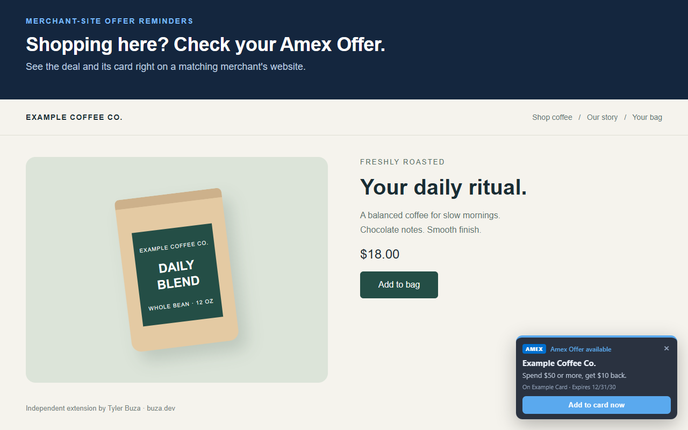
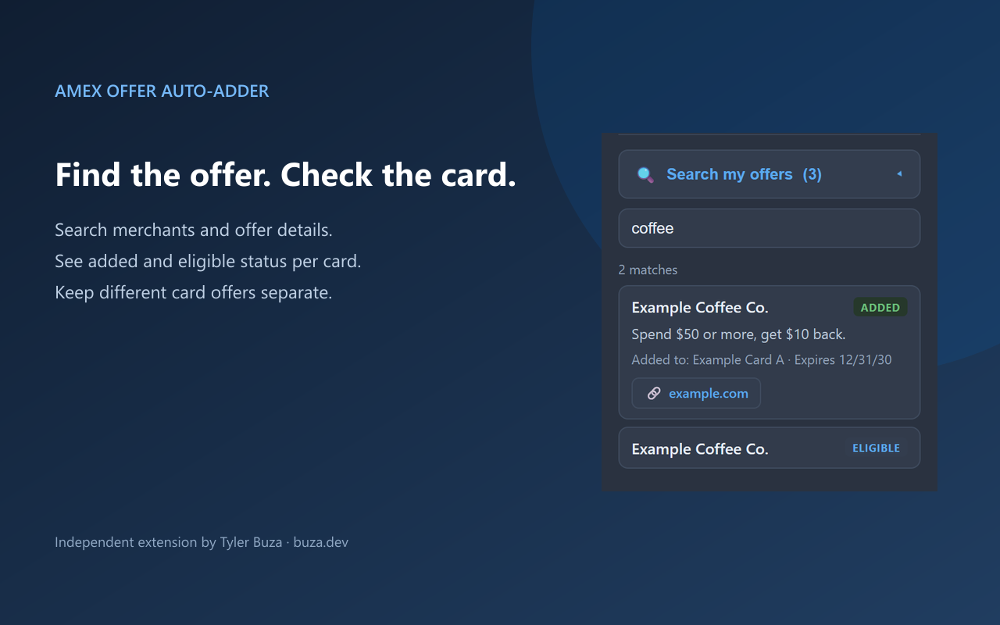

<h1 align="center">Amex Offer Auto-Adder</h1>

<strong>See the offer. Know which card to use.</strong> 
Get a reminder on a merchant’s site when one of your cards has a matching Amex Offer.

  

<a href="#firefox">Firefox install</a> · <a href="#quick-start">Quick start</a> · <a href="PRIVACY.md">Privacy policy</a>

  

That **“Spend $50, get $10 back”** reminder appears on the shop’s page itself. If the offer is already on a card, the reminder tells you which one. If it’s eligible but not yet added, choose **Add to card now** while signed in to Amex. Don’t want reminders at that shop? Use **×** to hide them for the session or permanently for that site.

## Quick start

1. **Install.** [Add the extension to Chrome][store] and pin it to your toolbar, or use the [Firefox instructions](#firefox) below.
2. **Load your offers.** Sign in to your US [Amex dashboard](https://global.americanexpress.com/). **Auto-add on visit** is on by default. You can also start a run from the popup with **Add offers now**. The run enrolls eligible offers and saves the offer list for search and reminders.
3. **Visit a merchant.** Leave **Merchant offer heads-up** on. When a site matches a saved offer, the reminder shows the deal, its card, and the expiry date if available. A less certain match is labeled **Possible Amex Offer**.

## Inside the extension

**Search by merchant.** Open **Search my offers**, type a name, and expand a result. In the Chrome Web Store edition, **Added** and **Eligible** are tracked separately for each card—even when two deals have the same description. Search shows the last run’s active offers; for a redeemed statement credit, check Amex’s savings history.

**Follow a run.** The toolbar icon and on-page progress message show when enrollment is running. The popup shows recent additions and a breakdown by card, including supplementary cards returned by Amex.

<strong>Screenshots: search, dashboard, and live progress</strong>

#### One merchant, two cards

#### Dashboard

#### Enrollment in progress

## Install

**Chrome:** [Install from the Chrome Web Store][store]. Chrome handles updates.

### Firefox

1. From the [latest GitHub release][release], download the **Firefox ZIP** (`amex-offer-auto-adder-firefox-v…zip`) and unzip it.
2. Open `about:debugging#/runtime/this-firefox` and choose **Load Temporary Add-on…**.
3. Select **`manifest.json`** inside the unzipped folder. Firefox removes temporary add-ons when it closes; repeat this step after restarting.

<strong>Manual install for Chrome, Edge, or Brave</strong>

1. Download the **non-Firefox ZIP** (`amex-offer-auto-adder-v…zip`) from the [latest GitHub release][release] and unzip it.
2. Open `chrome://extensions`, `edge://extensions`, or `brave://extensions`, depending on your browser.
3. Enable **Developer mode**, choose **Load unpacked**, and select the folder containing `manifest.json`.

The GitHub packages and the Chrome Web Store edition are released separately. Check the version on the download page you use.

## Privacy

The extension uses your existing Amex session. It keeps offer details, card labels, account references, and enrollment history in your browser’s local extension storage. Enrollment requests go to **American Express**. Merchant matching happens locally; the developer does not receive your Amex account data, offers, or browsing history.

On first install, `buza.dev` receives a random installation ID, extension version, and browser name to count installs. The server records a timestamp and a country code when available. The [privacy policy](PRIVACY.md) explains retention, network metadata, and what uninstalling removes.

## Troubleshooting

- **No reminder at a shop?** Check the last update in the popup and make sure **Merchant offer heads-up** is on. A reminder needs an unexpired offer in your cache that matches the site. If you previously hid the site permanently, use **Reset hidden sites** in the popup.
- **Nothing loads from Amex?** Confirm you’re signed in, reload the Amex tab, and try again. If Amex rate-limits a run, wait before retrying.
- **Still stuck?** [Report an issue][issues] with your browser, extension version, and what you expected to see. Omit card identifiers and account details from screenshots.

## Development

See the [developer guide](docs/DEVELOPMENT.md) for the enrollment flow, configuration, project layout, and build checks.

Independent extension by **[Tyler Buza](https://buza.dev)** · [MIT license](LICENSE). Not affiliated with or endorsed by American Express. Intended for personal use on your own account; automation uses undocumented endpoints and may be restricted by Amex’s terms.

[store]: https://chromewebstore.google.com/detail/amex-offer-auto-adder/binllhimembkpanceinpeogelljioehd
[release]: https://github.com/TylerBuza/amex-offer-auto-adder/releases/latest
[issues]: https://github.com/TylerBuza/amex-offer-auto-adder/issues
